<p align="center"></p>

# BooxUltimatum

**A suite of apps for the Boox Note Air6 C that needs no root: BooxUltimatum, with a home screen, a sleep screen designer, a battery doctor and reversible tweaks, and Nib, a drawing app that uses Boox's instant pen preview.**

   

[**Website and technical guide**](https://huuunleashed.github.io/BooxUltimatum/) · [Changelog](CHANGELOG.md) · [Contributing](CONTRIBUTING.md) · [Report a bug or a finding](https://github.com/huuunleashed/BooxUltimatum/issues/new/choose)

<p align="center">
  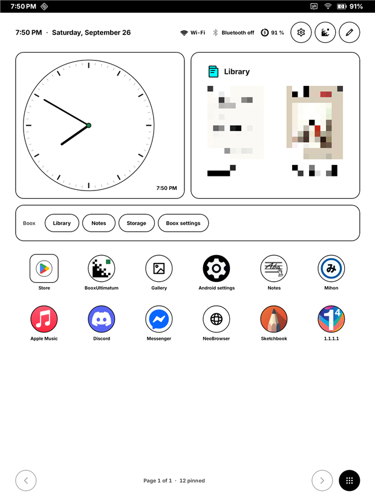
  &nbsp;
  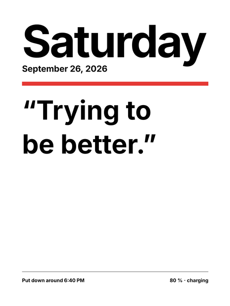
</p>

The Note Air6 C is a good tablet with two common complaints. Independent reviews such as [eWritable's](https://ewritable.net/brands/boox/tablets/boox-note-air6-c/) praise the screen and the pen, then point at the same two problems: short battery life, and software that scatters useful settings across a dozen places. BooxUltimatum is a set of apps that works on both from inside Android, rather than covering them with a skin. Each change is explained in plain words, checked on a real tablet and can be undone.

Nothing is flashed, and the bootloader stays locked. BooxUltimatum is one APK (an Android app file), and the apps that build on it, starting with Nib, install and uninstall on their own. Some features need more than the app alone. [How much access it needs](#how-much-access-it-needs) explains the levels: nothing at all, one-time permissions you grant from a computer with `adb` (Android's debugging tool), and Shizuku, a free helper app.

> **Status: public preview (0.12.0).** BooxUltimatum runs daily on the maintainer's Note Air6 C (firmware 4.3, Android 16) and hasn't been tested on other tablets yet. Download it from [Releases](https://github.com/huuunleashed/BooxUltimatum/releases), and please report how it behaves on your tablet. From 0.5 on, BooxUltimatum can update itself and help you file a report from its Device page.

## What it does

### A suite, not just a home app

BooxUltimatum is the centre of a small suite of apps. Its Suite page installs, opens, updates and uninstalls the suite's other apps. It also lists the modules built into BooxUltimatum: the home screen, the sleep screen, Instant ink and the battery log. Removing a module stops it and undoes what it changed, and its pages leave the menu until you add it back. The apps share one kit of libraries, so they have the same design, the same logbook, the same pen code and the same updater. Every suite app keeps a log of what it did and what went wrong, and tidies its own leftovers. Cache files go after three days, downloaded updates after a day and shared exports after a week, and logs stay under 8 MB and two weeks. Drawings, sleep screen pictures, fonts, the battery log and settings are yours, so they are counted but never cleared. Device › Logs shares every app's logs as one zip file, and Device › Storage shows and clears what each app keeps.

### Nib: drawing with Boox's instant pen

Nib draws the way Boox Notes writes. The display paints each stroke under the pen tip at once, and the moment you lift the pen, Nib's own drawing takes its place. It's built for drawing rather than notes:

- **Brushes.** Pens, pencils, markers, brushes and textured charcoal. While you draw, each brush is previewed in the closest of the display's styles.
- **Widths** down to a fraction of a millimetre.
- **Layers.** As many as you need, each with opacity, visibility and locking. Boox Notes stops at five.
- **Zoom like a drawing app.** A pen's width and the pencil's grain belong to the page, so a stroke is the same stroke at every zoom, and it grows on screen in proportion. At the zoom it was drawn at, it matches the display's preview dot for dot.
- **The rest.** Undo, zoom that keeps the preview and the result matching, crash-safe autosave, and PNG export.

Nib's tools float over a full-screen page like cut cards on a desk. The pens are drawn as their own strokes, and every brush property has a slider with − and + buttons and a typed value. The Brushes, Colour and Layers cards can be pinned and moved. Nib also has a lasso that moves, resizes and turns strokes, a page you can turn, paper guides, and exports with or without the paper, or layer by layer. It works without BooxUltimatum, Shizuku or a computer.

From 0.3, Nib writes the way Boox's own apps do. This instant ink is still experimental, so Settings › Writing has a switch that turns it off and lets Nib draw every stroke itself. The display holds the page for the whole writing session, so quick strokes follow each other without a pause, and Nib's ink replaces the preview when you stop to use a card, a panel or a gesture. Nib's pens are matched to Boox's own: the preview gets each brush's pressure sensitivity, tilt and nib angle, and textured brushes show Nib's exact ink after you pause. The display draws the eraser end and the lasso too, and the page refreshes fast while fingers move it. An optional palm guard turns off finger touch while the pen is near. See [Known limits](#known-limits), [`docs/08-nib.md`](docs/08-nib.md) and [`docs/09-ink.md`](docs/09-ink.md).

### A home screen made for e-ink

<p align="center">
  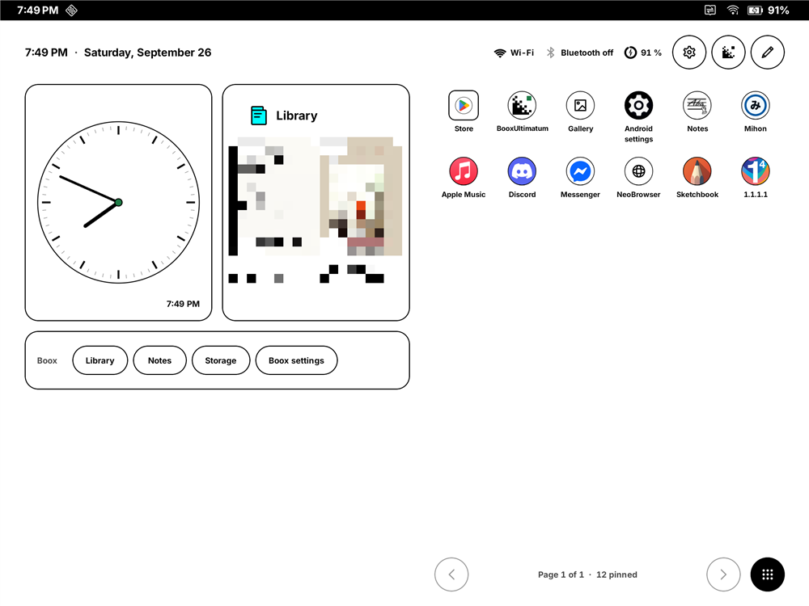
</p>

BooxUltimatum home is a calm, paper-white home screen. Measured on a Note Air6 C, it uses about a third of the memory of the Boox home and no processor time when idle.

- **Widgets:** clock, month, agenda, weather, battery, next alarm, a note, a Boox shelf (Library, Notes, Storage) and any app's widget, including Boox's own. Library covers are pixelated in these screenshots.
- **Apps:** paged grids you turn with a swipe, folders, and icon shapes that remove the frame Boox draws into its own icons. Apps that Boox has frozen, which stops Android from starting them, are listed dimmed with a frozen tag. With Shizuku, tapping one unfreezes and opens it. BooxUltimatum freezes it again about a minute after you are back on the home screen, and when the tablet locks (checked on a Note Air6 C on 2026-10-12). Without Shizuku, you can turn such an app on in Boox's App Freeze page instead.
- **The header:** shows the time, network, Bluetooth and battery, with 8 Wi-Fi and 8 battery designs to choose from, plus buttons for Boox Settings and BooxUltimatum.
- **All apps:** includes the Boox functions that have no app icon of their own, sorted by name, colour or recent use.
- **Layout:** two panes in landscape, and nothing shifts while you type.

<p align="center">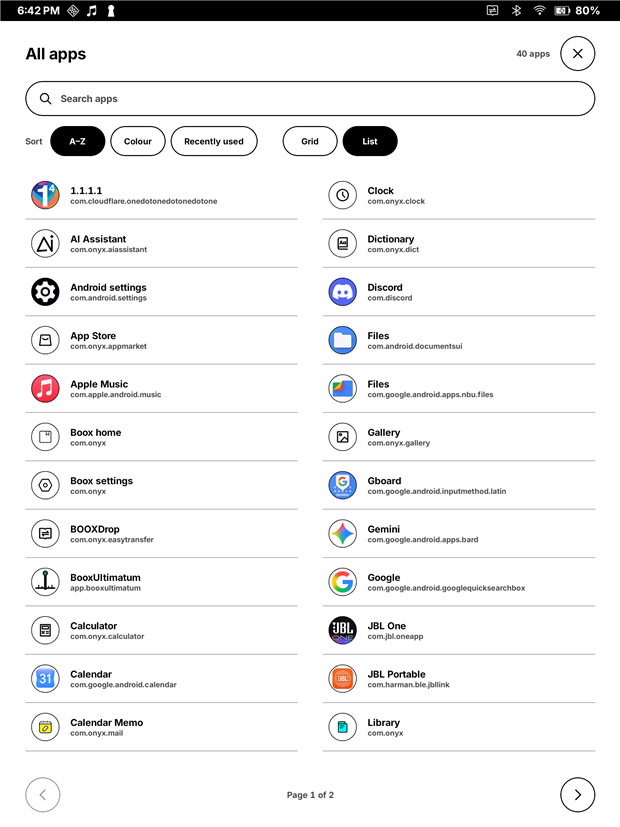</p>

### Your own sleep screen

<p align="center">
  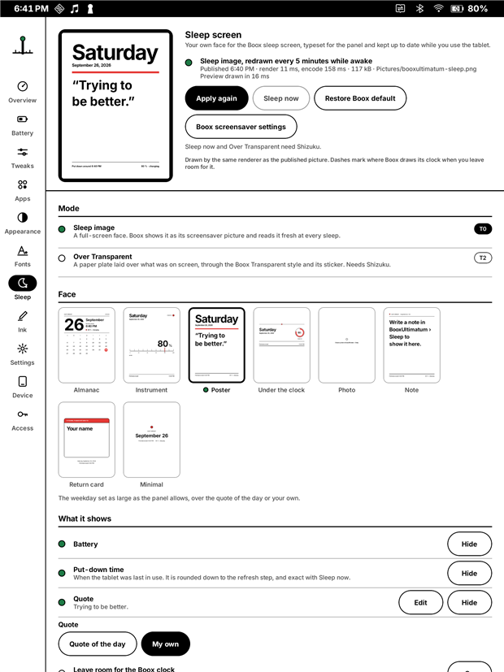
  &nbsp;
  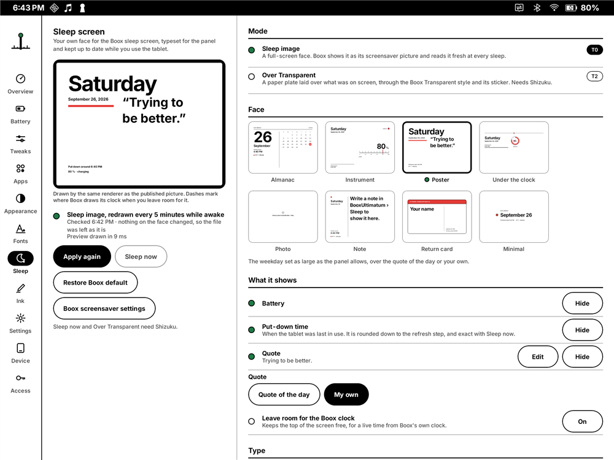
</p>

Boox gives you six preset screensavers. BooxUltimatum gives you twenty-one faces, which are designs for the sleep screen, the picture the tablet shows while it sleeps. They are set in *your* tablet font or any font you install, from a wall clock in the style of Braun and a 3D cube to a split-flap board, a dashboard and a newspaper front page. Each has its own portrait and landscape layout.

- **Kept fresh:** Boox reads the picture only as the tablet goes to sleep, so BooxUltimatum quietly redraws it while you use the tablet. It redraws every 5 minutes by default, and whenever the battery, date or rotation changes. Because the picture can't change once the tablet sleeps (see *While asleep* below), the time it shows is honest: it says when you put the tablet down, for example "Put down around 4:30 PM".
- **While asleep (off by default):** the face can also update while the tablet sleeps, every 1 to 60 minutes (1, 5, 10, 15, 30 or 60), and it covers Boox's charging bar. The one-minute step runs only while charging. Updates need three things, all allowed on the tablet itself. The first is an accessibility service, which Android lets draw over the lock screen. BooxUltimatum's only holds the picture, reads nothing and shows nothing while the screen is on. The other two are permission to run in the background and permission for exact alarms, which keep updates on time. Each update wakes the tablet for about a second and a half. Measured on a Note Air6 C, the one-minute step cost about 1.6 mAh an hour, and the five-minute step wakes the screen a fifth as often.
- **Twenty-one faces, twelve of them live.**
    - The twelve live faces keep time while the tablet sleeps, when updates while asleep are on: Dial, Clock, Monitor, Cube, Split-flap, Dashboard, Word clock, Day ring, Timeline, LCD, Sky and Broadsheet.
    - The nine still faces show one picture for each sleep: Almanac, Year, Instrument, Poster, Under the clock, Photo, Note, Return card and Minimal.
    - Many faces have options of their own, such as Dial styles, 12- or 24-hour time, the Dashboard's tiles and the Cube's shading.
- **A face shows only what the tablet already knows:**
    - Calendar events, when you allow access.
    - The home screen's weather, with how old it is.
    - Sunrise and sunset for the home screen's weather city.
    - The moon's phase, worked out on the tablet.

  Without updates while asleep, a clock face shows when the tablet was put down and says so.
- **Rotation:** BooxUltimatum keeps both orientations ready, so turning the tablet never leaves you with a cropped face.
- **Over Transparent:** Boox's Transparent style shows the screen as it was when the tablet went to sleep, with a sticker (a see-through picture) laid over it. The *Over Transparent* mode keeps that style and draws a small paper plate on the sticker instead of replacing the screen. Boox keeps only the middle of a sticker when the tablet sleeps on its side (read from Boox's own code). So plates are drawn inside the band that survives either orientation, which makes one file right both ways. BooxUltimatum keeps the plate current through Shizuku or, without it, through one Android permission to change Boox's sticker picture, which you give from the Sleep page.
- **Power-off screen:** you can also use the face as the picture the tablet shows while it is off, with one tap, through the same Boox interface. Boox keeps a copy, so the picture changes only when you update it. It is drawn in portrait without the battery and the put-down time, and a live face is replaced by the Almanac, because a clock would stop.

### Instant ink for other apps (experimental)

<p align="center">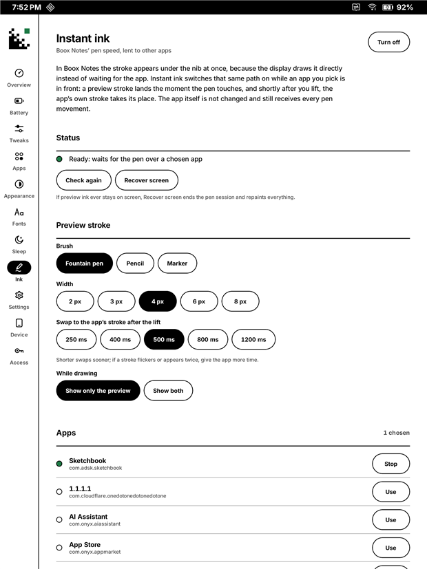</p>

In Boox Notes, ink appears under the pen tip in about 10 ms. In Sketchbook and most other apps, it trails behind. The reason is that Boox Notes uses a firmware feature in which the display system draws the stroke straight from the pen, ahead of the app. Onyx offers that feature to app developers through its public [pen SDK](https://github.com/onyx-intl/OnyxAndroidDemo/blob/master/doc/Onyx-Pen-SDK.md), a toolkit for drawing inside their own app, but most apps don't include it. BooxUltimatum turns on the same feature from the outside for the apps you choose, and hands the stroke back to them after you lift the pen.

A preview stroke appears at once. When you pause (0.8 s by default, and you can choose 0.4 to 2 s), the app's own brush takes its place. Quick strokes share one preview, as in Boox's own apps. The display holds back the app's own drawing while the pen touches the screen, so the app's brush and colour always appear after you lift the pen. Instant ink keeps a paused display session ready, so even the first stroke after unlocking or switching apps gets the preview, and it steps aside for Boox's own apps.

The drawing app isn't modified in any way, and Instant ink needs no root. It needs only *usage access*, a permission you allow on the tablet so that BooxUltimatum knows which app is in front. It also needs no Shizuku, unless the display doesn't answer BooxUltimatum directly, in which case it connects through Shizuku instead. A Quick Settings tile (a button in the menu you pull down from the top of the screen) and the buttons on its notification turn Instant ink off or recover the screen without leaving your app. The Ink page shows what it found (pen input and display route) and has a pen test, which helps most in a report from another tablet. You can adjust the preview's brush (pencil, fountain pen, marker, brush pen, or a grainy pencil that follows tilt) and its width. Instant ink is new and has only been tried in Sketchbook so far, next to Boox Notes. See [Known limits](#known-limits).

### A battery doctor that doesn't drain the battery

<p align="center">
  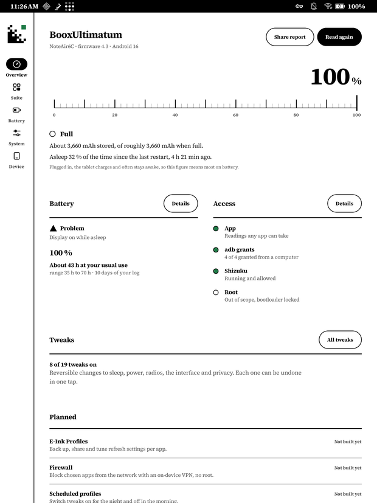
  &nbsp;
  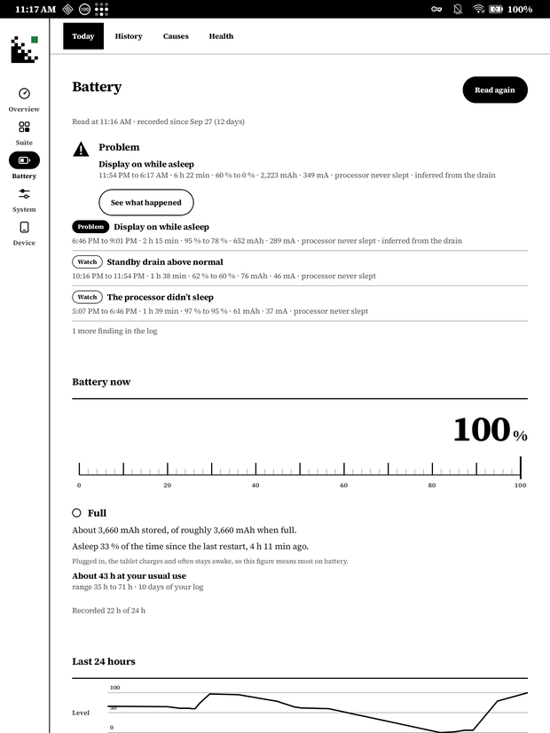
</p>

- **Today** says whether the battery is OK. It gives a verdict (Normal, Watch, Problem, or Not enough data yet), the findings behind it with their numbers and never a guessed cause, the charge, and how long it should last at your usual use, with its range and what it rests on. A 24-hour strip shows the day, with a written list of what happened as its text version.
- **History, Causes and Health** cover windows of 24 hours to 30 days. They show the standby draw (the battery used while the tablet sleeps) day by day, discharge sessions, and marks that show whether a change helped, or say it can't be told apart from a normal day. They also show what used the battery by state and by app, what kept the tablet awake, the battery's learned capacity and condition, and a battery report you can share. The by-app figures need usage access. Wake locks (requests from apps to keep the tablet awake) and wakeups are recorded only with `adb` grants or Shizuku.
- **Battery log:** BooxUltimatum records every screen, plug and level change, with the display's state and the app in front, without ever waking the tablet. It also notices when the display stays on while the tablet sleeps. You can export or share the log from History.
- **A morning report, and a way to switch off a display that stays on:** the morning report is a quiet notification after a night asleep. It is on by default, with a switch on Today. The experimental safeguard, *Switch off a display that stays on*, is on unless you turn it off. It starts two minutes after the display stays on while the tablet sleeps. It tries five steps in turn: ask the Boox sleep screen to refresh, tell it the display is on, lock the screen, wake and lock the tablet, and, with Shizuku, press the wake and sleep buttons. It tries again at 5, 10, 20 and 40 minutes and then hourly, until the display is off. None of the steps has been seen to work yet. Each try is logged with its result.
- **Refresh the sleep screen while asleep (0.10.1):** if nothing has refreshed the sleep screen for 30 minutes while the tablet sleeps, BooxUltimatum asks it to refresh. A refresh costs about 0.04 mAh. On the maintainer's Note Air6 C, the display stuck on exactly 90 minutes after the sleep screen last refreshed. The refresh is meant to keep that point from ever being reached, day or night. Its switch is on Today. It is a precaution against a pattern seen in four episodes, not a proven cure.
- **The processor stayed awake while the tablet slept (0.10.2):** after Android restarts by itself (its system process crashes and starts again while the tablet stays on), the tablet's processor can stay awake through every sleep until the tablet is restarted. That uses several times the normal standby power, and it is followed, 90 minutes after the sleep screen last refreshed, by a display stuck on. The refresh above already wakes the tablet every 30 minutes, and at each one BooxUltimatum now checks whether the processor was awake for nearly all of the time since the last. If it was, a notification that can't be swiped away says so within about 30 minutes of the sleep starting. It advises restarting the tablet or, when an app is holding the processor awake, says that an app is, without naming it. BooxUltimatum also keeps the power state at that moment, and what it did itself just before Android's last restart, so the cause can be looked for. The cause can't be read from the kernel (the core of Android's system) without root. Battery › Today now tags such sleeps *Processor stayed awake*, leaves them out of what counts as a normal sleep, and no longer reports them as a stuck display (it had listed seven that were not). This has not yet been seen on a tablet in that state.
- **Findings so far on the maintainer's Note Air6 C:** standby is low (about 15 mA over its last ten days, 9 mA on its quietest nights) as long as the display goes to sleep. Screen-on use is where the battery goes, mostly because background downloads, music and chat apps keep the processor awake. The tweaks aim at exactly that. One exception is large: on 2026-10-08 the display stayed on while the tablet slept, twice, and drew 330 mA until the battery died (see Known limits).

### Tweaks you can undo

<p align="center">
  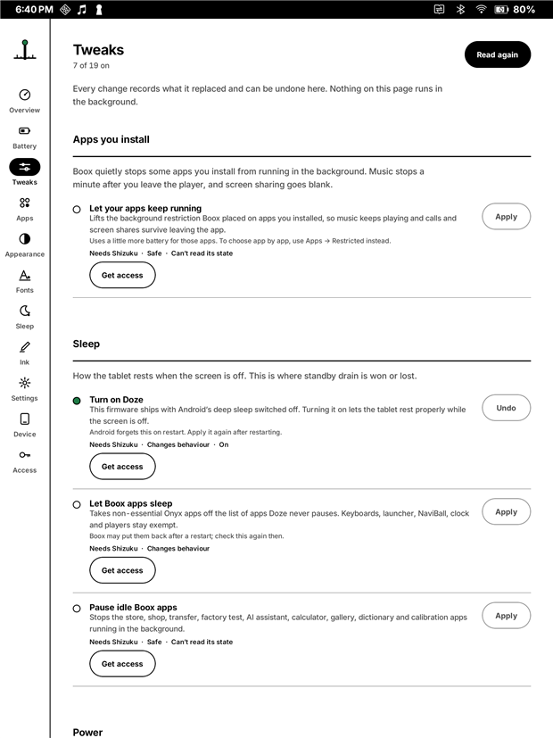
  &nbsp;
  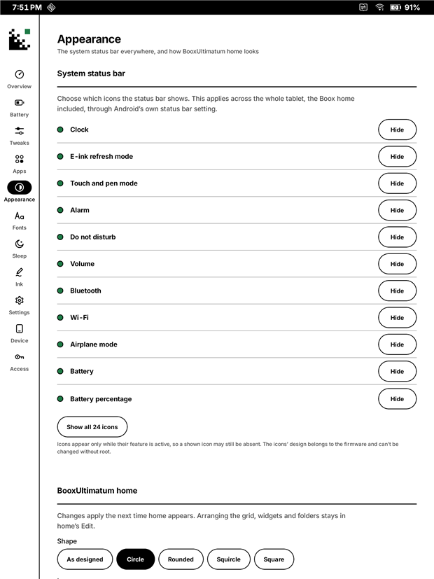
</p>

BooxUltimatum has 19 tweaks, which are reversible changes to Android's settings, across apps, sleep, power, radios (Wi-Fi and Bluetooth scanning), interface and privacy. Every tweak records what it replaced, and tapping *Undo* restores it. Some examples:

- **Let your apps keep running.** Boox stops every app you install from running in the background, which is why music can stop a minute after you leave the player. This tweak lifts that restriction for all of them at once, and needs Shizuku. Those apps may then use more battery. Without Shizuku, an app's page under Apps links to Android's battery page, where you can allow one app at a time.
- **Let Boox apps sleep**, **Turn on Doze** and **Pause idle Boox apps** help the tablet rest. They take non-essential Boox apps off the list of apps that Android never puts to sleep, turn on Doze, which is Android's deep-sleep mode and which the firmware turns off (checked on a Note Air6 C), and stop idle Boox apps from running in the background. These tweaks need Shizuku.
- **Status bar icons**, shown or hidden across the whole tablet. This needs the `adb` grants or Shizuku.
- **The tablet font**, for the whole tablet, at a heavier weight if thin strokes look faint on e-ink. It needs no root and no Shizuku.

<p align="center">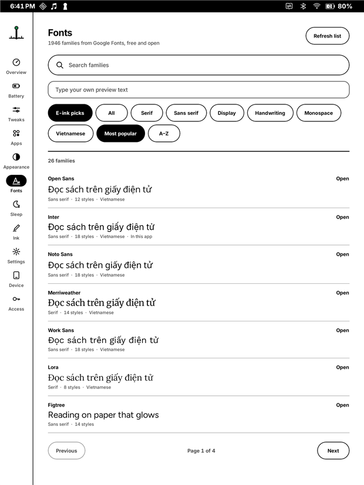</p>

The **Google Fonts browser** lists 1946 families, with a Vietnamese filter, and installs a font for the tablet, NeoReader (Boox's reading app), BooxUltimatum home, BooxUltimatum's own screens or the sleep screen. Installing into the Boox fonts folder, which NeoReader reads, needs Shizuku. The **font manager** lists what BooxUltimatum installed, where each font is used and how much space it takes. You can turn fonts off and on, or delete them. Before it turns off or deletes a font, BooxUltimatum returns every use of it to its default. It never touches fonts it didn't install.

## How much access it needs

Most of BooxUltimatum works straight after installing, with no computer, no Shizuku and no root. Every feature asks for the least access it needs. When a higher level is missing, BooxUltimatum shows what the feature can still do and where to find the switch to do it yourself.

| Level | What it is | What it adds |
| --- | --- | --- |
| **T0: just the app** | Nothing to set up, or a switch you allow on the tablet itself | Nib, the drawing app, entirely. The suite's logbook and installs. The home screen, and the designer for the sleep screen and the power-off screen. Updates for the sleep screen **while asleep** (an accessibility service and background use). **Instant ink** (usage access). Battery measurement and the battery log, the Google Fonts browser, **the tablet font**, the Settings page, and making BooxUltimatum your home screen (Android asks you to confirm). For apps Boox restricts, a one-tap link to Android's own battery page and to Boox's hidden App Freeze page, which is also on the Settings page. |
| **T1: a one-time setup from a computer** | Four permissions granted once over `adb`, Android's debugging tool (five commands on Android 16, which asks for `READ_DROPBOX_DATA` as well as `READ_LOGS` to read where a restart of Android is recorded). They survive restarts of the tablet | Reading battery statistics inside BooxUltimatum, showing or hiding status bar icons across the whole tablet, and the tweaks that change system settings |
| **T2: Shizuku** | [Shizuku](https://shizuku.rikka.app), a free app that runs a small helper with the same rights as `adb` | Most tweaks (Doze, Battery Saver, pausing Boox apps), reading and lifting Boox's background restriction for every app at once, switching the home screen in one tap, opening Boox-frozen apps from home (and freezing them again), the Wi-Fi network name in the header, *Sleep now*, and the *Over Transparent* sleep mode (without Shizuku, it needs a permission you give from the Sleep page) |
| T3: root |  | Not needed. BooxUltimatum works without it and doesn't ask for it |

**About the status bar:** BooxUltimatum can show or hide the system's status bar icons across the whole tablet (T1). The custom Wi-Fi and battery designs are drawn only in the header of BooxUltimatum home. Replacing the system's own icon artwork would need a system overlay, which Android allows only with root, so that isn't possible.

### What Shizuku is, and how to start it

Shizuku is a free app that lets other apps run the same commands you could type over `adb`, without root. It needs `adb` to start its helper, either from a computer or, on firmware that offers it, through wireless debugging on the tablet. On firmware 4.3, the helper stops whenever the tablet restarts. BooxUltimatum works without Shizuku, which only adds the features in the T2 row. If a tweak says it didn't work although Shizuku is running and allowed, open Device › Access and tap *Test Shizuku*. It shows which step between BooxUltimatum and Shizuku stops, and copies the result for a report.

1. Install Shizuku from [GitHub](https://github.com/RikkaApps/Shizuku/releases) or Google Play.
2. On the tablet, turn on USB debugging: Boox Settings › More Settings › USB Debug Mode (firmware 4.3).
3. Plug the tablet into a computer with [platform-tools](https://developer.android.com/tools/releases/platform-tools) (the download that includes `adb`) and accept the "Allow USB debugging" prompt.
4. From this repository, run the setup script once, then the Shizuku script, and run the Shizuku script again after every restart of the tablet:

```powershell
# Windows
.\tools\host\grant-permissions.ps1   # T1, once
.\tools\host\start-shizuku.ps1       # T2, after every reboot
```

```sh
# macOS / Linux
./tools/host/grant-permissions.sh    # T1, once
./tools/host/start-shizuku.sh        # T2, after every reboot
```

Without the scripts, the T1 grants are these commands. The fourth is needed, and exists, only on Android 16 firmware such as 4.3, where reading the dropbox (Android's record of crashes and restarts) asks for it in place of READ_LOGS:

```text
adb shell pm grant app.booxultimatum android.permission.WRITE_SECURE_SETTINGS
adb shell pm grant app.booxultimatum android.permission.DUMP
adb shell pm grant app.booxultimatum android.permission.READ_LOGS
adb shell pm grant app.booxultimatum android.permission.READ_DROPBOX_DATA
adb shell appops set app.booxultimatum GET_USAGE_STATS allow
```

Firmware 4.3 hides the Wireless debugging switch from Developer options, and the platform has no `android.settings.WIRELESS_DEBUGGING_SETTINGS` screen at all, so Shizuku can't be started from the tablet itself. It can be started from any computer over `adb`, including over Tailscale (a private network between your own devices). Once started, it keeps running on its own. This was verified on a Note Air6 C on 2026-10-05, at 7 h 17 m of uptime, across a sleep and a lost `adb` connection. It doesn't survive a restart of the tablet. Making it survive restarts is on the roadmap.

## Install

**From a release:** download `BooxUltimatum-0.12.0.apk` from this repository's [Releases](https://github.com/huuunleashed/BooxUltimatum/releases) page, allow your browser or file manager to install apps, and open it. The Access page shows what each level unlocks and the exact commands for it. Releases are signed with the project's own key, so later releases update it in place. BooxUltimatum's Suite page installs Nib for you. You can also download `Nib-0.4.2.apk` from the same page, where Nib's releases are tagged `nib-v…`.

**Test builds:** unfinished builds of BooxUltimatum or Nib are sometimes published as `test-…` pre-releases, so they can be checked on a real tablet. BooxUltimatum offers them only when *Offer test builds* is turned on (Device page). A release always replaces its own test build.

**Development builds:** every commit on `main` also builds debug-signed APKs of BooxUltimatum and Nib, which are signed with a developer key rather than the release key. Open the latest successful [Build run](https://github.com/huuunleashed/BooxUltimatum/actions/workflows/build.yml) and download `booxultimatum-debug-signed` or `nib-debug-signed` under Artifacts (GitHub asks you to sign in). They use a different key from the releases, so Android won't install one over the other, or a debug build of one suite app next to a release of another. Uninstall the app first when switching, which also clears its settings.

**From source:**

```powershell
# JDK 21 and the Android SDK (platform 36) are required.
$env:JAVA_HOME = 'C:\Program Files\Eclipse Adoptium\jdk-21.0.8.9-hotspot'
.\gradlew.bat assembleRelease                  # -> hub\build\outputs\apk\release\hub-release.apk
adb install -r hub\build\outputs\apk\release\hub-release.apk
```

Without a signing key, that build is debug-signed, which is fine for a tablet that has no BooxUltimatum yet. A tablet already running the published release needs a build signed with the same key, or Android refuses the update. The maintainer's key lives outside the repository (see [`AGENTS.md`](AGENTS.md) › Releases).

### Using it as your home screen, and going back

Suite › Home screen › *Use this* makes BooxUltimatum home your home app. It first records the Boox home, so going back never loses anything:

- **On the tablet:** Suite › Home screen › *Go back to Boox*. You can also tap *Notes* on the Boox shelf to use the Boox home for a moment.
- **From a computer**, if BooxUltimatum ever won't open: `adb shell cmd package set-home-activity --user 0 com.onyx/.StartupActivity`.
- **Without either:** Android Settings › Apps › Default apps › Home app › ONYX Launcher.

The recent apps screen, Boox gestures, NaviBall and EinkWise stay with Boox, so they work the same under either home.

## Languages

The apps follow the tablet's language, so a Chinese tablet reads Chinese with nothing to choose. You can choose another one, and the choice is kept for the app alone.

- **In the app:** Device › Language in BooxUltimatum, and About › Language in Nib.
- **In Android's own settings, on Android 13 and later:** Settings › Apps › App languages. The app and Android's own screen write to the same place, so they never disagree.

BooxUltimatum, Nib, the shared kit and the updater read in **Simplified Chinese** and in **Vietnamese**.

Two things to know:

- **Each app keeps its own language.** BooxUltimatum and Nib are separate programs, so choosing Chinese in one does not change the other.
- **Chinese text is drawn in the tablet's own font.** The app's bundled face, Archivo, has no Chinese characters, so the words fall back to the tablet's system font. A tablet whose system font has no Chinese needs a font with Chinese coverage, which the Fonts page can install.

The Vietnamese was written with an assistant and checked against the English by script, which holds the words, the values and the plural forms right, but says nothing about how it reads. A reader who writes Vietnamese is welcome to correct it; a new language is a folder and a line, and the convention is in [`docs/12-languages.md`](docs/12-languages.md).

## Known limits

- **Nib is new:**
  - Nib 0.3's way of writing was checked on a Note Air6 C through ten test builds: one hold per writing session, SurfaceFlinger (Android's display compositor) reporting every held stroke's frame, and the pencil and the brush pen against their previews. Still to be confirmed on a tablet: the palm guard, pushing ink and cards into the display (Diagnostics › Lab), and Nib 0.3.0's faster lasso drag in the display's fast mode.
  - While you write, the page shows the display's preview. With the pens matched to Boox's own, it looks like the ink. Other brushes show Nib's ink after you pause.
  - A pen's width belongs to the page, so a stroke is the same width on the page at every zoom. The display adds some pixels of its own: the fountain pen's ink is drawn 3 px wider than the width the display is sent, as Boox Notes draws its own, and the pencil's stamp is 1.16 x width + 5 px. So Nib sends the display less than width x zoom, and the stroke then matches. The maintainer checked that on a Note Air6 C through the Nib 0.4.1 test builds. Diagnostics › *Match preview* tunes any style's preview size.
  - The pencil is drawn as the display previews it: in Boox's 1-bit stipple (a pattern of black dots) with tilt. The maintainer finds the two all but identical. The pencil's thinnest line is about 6 px on screen, so zoomed far out a stroke is thicker on the page than at 100 %. Its grain scales with the page like an image, so it shows as blocks of pixels when magnified and as the display's own dots at the zoom a stroke was drawn at. The brush pen and the highlighter draw only what the display can preview, with no taper, speed thinning or chisel nib. Only the fountain pen's pressure response can be changed, because the display follows pressure for no other pen. The marker's preview is solid where its ink is see-through, because the display drops translucent colours. Fineliners under 1 px look darker in the preview than their smoothed (anti-aliased) ink.
  - Styles 3 to 7 (neo brush, charcoal, dash, charcoal v2, square pen) are the ones Boox Notes uses, but they haven't been judged on a Note Air6 C with their settings. How thin a preview the display draws cleanly isn't measured yet.
  - Marker and highlighter previews are in solid colour, covering what's under the stroke until you lift the pen, because the display drops translucent colours. Blue looks grey in the preview on a Note Air6 C. Settings › Display offers a see-through grey instead.
  - Nib's Diagnostics page asks what the display shows and records your answers in Nib's log. Sending them from another tablet helps most.
- **One signing key for the whole suite.** Every suite app declares the same signature permission, which only apps signed with the same key can hold. So a development build, signed differently, can't be installed next to a release of another suite app. Install both from Releases, or both from the same build.
- **One tablet, one firmware.** Everything is verified on a Note Air6 C with firmware 4.3. The Note Air4 C and Air5 C run very similar Boox software, so much of it may work there, but nothing is tested on them yet. Results from those tablets, and from other Boox models, are the most welcome contribution. Use the *Device finding* issue form.
- **Unofficial interfaces.** BooxUltimatum relies on parts of the Boox firmware that Boox hasn't promised to keep. The sleep screen and power-off screen broadcast and the pen path appear in Onyx's own SDK, and the tablet font switch is used by Boox's own apps. None of them is a stable, documented public API (a published interface for app developers). Instant ink also uses the pen path in a way the SDK doesn't offer, on behalf of another app, through the firmware's display calls. A firmware update can change any of these without notice. When something stops working, BooxUltimatum says so rather than guessing.
- **Instant ink is experimental:**
  - The preview is Boox's own black pen, so a coloured brush or the eraser shows only once the app's stroke takes over. The firmware holds the app's own drawing while the pen touches, so the two can't be shown together.
  - After Boox Notes has been used, the first stroke in a chosen app can miss the preview once, because Boox's apps sometimes end the waiting session.
  - Instant ink has been tested with a real pen in Sketchbook only. Other drawing and note apps are the next thing to try.
- **Updates while asleep have limits.** They are verified on battery on a Note Air6 C. Measured there, the one-minute step cost about 1.6 mAh an hour, and the five-minute step wakes the screen a fifth as often. The faces don't yet have much that changes while the tablet sleeps. Without updates, Boox doesn't read the picture again until the tablet wakes. The power-off screen is a copy Boox keeps, so it changes only when you set it again. Updates work only in Sleep image mode: Boox doesn't reload a sticker during a sleep, so an Over Transparent plate is redrawn only while the tablet is awake.
- **Over Transparent hasn't been checked on a sleeping tablet yet.** The band Boox keeps, the write permission and the way BooxUltimatum follows a re-picked sticker are all read from Boox's own code and checked against renders on an emulator (a virtual tablet on a computer), not against a sleeping tablet. The Sleep page says which file and which route it is using.
- **Charging:** without updates while asleep, Boox always draws its battery bar over the sleep screen while the tablet charges. With updates, BooxUltimatum's overlay covers the bar as the tablet goes to sleep. The bar showed for about six seconds before 0.10.0.
- **Quiet hours:** *Not at night* pauses the updates between two hours you choose, and the picture says "Paused until 07:00" at its top edge while it does.
- **The display can stay on while the tablet sleeps, and the cause isn't known.** It happened on the maintainer's Note Air6 C on 2026-10-08 (twice), on 2026-10-12 (62 % to 18 % in five hours) and on 2026-10-13, when the battery ran out. Each time it was exactly 90 minutes after the display last went to sleep, with nothing refreshing the sleep screen in between. Each time, Android's system process had crashed and restarted, with no restart of the tablet since. A real restart on 2026-10-09 was followed by three clean nights, and the daytime sleeps in the same state were fine, because the live sleep screen refreshed every 5 minutes.

  BooxUltimatum notices it: the log records the display's state, Today flags it as a Problem, and the morning report says so. The safeguard that switches off a display that stays on (on by default since 0.10.1) keeps trying to undo it. A refresh of the sleep screen every 30 minutes means the 90 minutes never run out. After a restart of Android by itself, BooxUltimatum keeps a note in the notifications until the tablet is restarted. Since 0.10.2 it also says so within about 30 minutes of a sleep in which the processor stayed awake, with or without a crash in Android's log. That state also stops the tablet sleeping deeply. The processor never suspended in the sleeps after the last restart, which used 10 to 46 mA asleep instead of about 7. Only a restart clears it. This is a pattern from four episodes, not a known cause, and neither the refresh nor any step of the safeguard has been seen working. Restart the tablet after any unexpected restart of Android.
- **Charge limit:** Boox's *Charging protection* stops charging at 80 %. Other levels would need root, because the files that set the limit are closed even to Shizuku.
- **Other Boox models and other tablets:** BooxUltimatum recognises Boox tablets and, on other tablets, hides what needs Boox firmware (the sleep screen and Instant ink). Instant ink had no effect on a Note Air 2 Plus or a Go 10.3 Gen II Lumi. The Ink page now shows why, and those reports are still open.
- **Shizuku stops on every restart**, and on firmware 4.3 starting it again needs a computer (see [How much access it needs](#how-much-access-it-needs)). Everything in the T0 row works without it.

### Updates and reports

The *BooxUltimatum* plate on the Device page checks this repository's releases. It checks at most once a day when BooxUltimatum opens, or when you tap *Check for updates*. It downloads the APK, checks its SHA-256 checksum and its signing key, and passes it to Android's installer. Development builds, which are signed differently, say so and don't offer updates. *Report a problem or idea* fills in a GitHub issue form, or copies or shares the report. You choose which parts to include and can preview each one. Nothing is sent until you tap *Open on GitHub* or *Share*.

## Privacy

BooxUltimatum has no accounts, analytics, ads or trackers. It goes online for three things only: weather from [Open-Meteo](https://open-meteo.com) (which receives the city name you type, and never your own location), fonts from Google Fonts when you open the font browser, and GitHub's release list when it checks for updates, for itself and the suite's apps. Nib goes online only to check GitHub for its own updates, at most once a day, and only when BooxUltimatum isn't installed to do it. Neither app sends its logs anywhere. You share them yourself. The battery log stays on the tablet until you choose to share it, and a problem report is sent only when you open it on GitHub or share it yourself.

## Disclaimer

BooxUltimatum is an independent project. It is not affiliated with, endorsed by or supported by Onyx International or BOOX. "BOOX", "Note Air" and related names are trademarks of their owners, used here only to say which tablet this is for.

BooxUltimatum changes system settings and, if you ask it to, the home screen, the sleep screen and how other apps draw. Every change is recorded and reversible, and nothing touches the system partitions or the bootloader. Still, this is preview software that relies on behaviour Boox hasn't documented, so **use it at your own risk**. As the GPL says, it comes with no warranty (sections 15 and 16 of `LICENSE`).

## Roadmap

No dates are promised. This is a spare-time project, and each release ships when it works on a tablet.

- **0.4, first public preview (released)**
  - A release-signed APK on GitHub Releases.
  - Instant ink that holds frames from the moment the pen hovers, so a stroke's first millimetres are kept, with a working width, checked with a real pen in Sketchbook.
  - A sleep face as the power-off screen too.
  - More of BooxUltimatum working without Shizuku: the tablet font, becoming the home app, and one-tap links to the background controls Boox hides.
- **0.5, the sleep screen while asleep (released)**
  - Updates while asleep, verified on battery, and twenty-one faces, twelve of them live, many with options of their own.
  - In-app updates and problem reports.
  - Instant ink diagnostics for other Boox models: the usage access check, pen detection by behaviour, and a pen test.
  - One tablet profile, so tablets that aren't Boox get only what works there.
  - 0.5.1: a steadier Instant ink, with a session kept ready so the first stroke is previewed, and a Quick Settings tile.
- **0.6, the suite (released)**
  - BooxUltimatum as the centre of the suite: a Suite page that installs and updates the suite's apps, and built-in modules that can be removed and added back.
  - A logbook in every suite app, with crash capture and one shared export.
  - Five-section navigation.
  - Nib 0.2, the first release: instant preview, many brushes, fine widths, unlimited layers, a lasso, a page that turns, paper guides, undo, autosave and exports, with floating cards and a Diagnostics page for the tablet.
  - A font manager, a Storage page, and logs and leftovers kept within limits in every suite app.
- **0.7, steadier sleep and ink, home keeps frozen apps (released 2026-10-01)**
  - Sleep live updates every minute, with the battery cost measured at about 1 % per one to two hours. (Corrected in 0.7.2: that is the whole tablet asleep. The one-minute step itself measured about 1.6 mAh an hour, and it now runs only while charging.)
  - Batched instant ink, where quick strokes share one preview, with a stronger recovery, and the computer command for usage access on the Ink page.
  - Home lists Boox-frozen apps dimmed instead of hiding them.
  - A Clean screen tile and button.
- **0.7.2, BooxUltimatum's own battery habits (released 2026-10-05)**
  - The live sleep screen woke the display 1 384 times in 32 hours, which was 98.7 % of every display wake on the tablet (measured on a Note Air6 C). So a one-minute step now applies only while charging, and 5 minutes on battery, giving back about 30 mAh a day.
  - The live wake lock is held for 4 seconds instead of 8, and every update now logs how long its render took.
  - The battery log's frontlight columns, empty in all 957 rows ever written, are filled through Shizuku and cached for five minutes.
  - What the battery really does, measured on a Note Air6 C from its own records: 229–551 mA while reading manga with a 291 mA average, a 10.2 mA idle floor, and 63.2 mA when the Wi-Fi radio stays busy.
- **0.7.1, the transparent sleep screen made to fit (released 2026-10-04)**
  - Over Transparent plates now sit inside the band Boox keeps in either rotation, measured on a Note Air6 C: one sticker file is right both ways up.
  - The plate can be kept current without Shizuku, through one Android permission to change Boox's sticker picture, with Shizuku still used when it runs.
  - A re-pick in Boox is followed, and Boox's own sticker comes back when you restore the Boox default.
  - The fixes a full check of the code turned up: Instant ink stopping for good and its notification being hidden, a failed update check silencing checks for a day, a battery rate that could divide by zero, and clearer, more honest wording on the Sleep page.
- **Still ahead from the 0.7 plan**
  - A one-tap reading mode: Wi-Fi and Bluetooth off, Battery Saver on and sync paused, all undone together.
  - Shizuku that survives a restart without a computer, and an in-app first-run guide for the `adb` grants.
  - The first overnight and before-and-after results shown in the app.
  - Instant ink tried in more drawing and note apps, and on the models testers reported.
  - Apply-and-undo tests recorded for the last three unverified tweaks.
  - Refinements to the faces from how they look on the screen.
  - Over Transparent seen through a real sleep in both orientations, and on the route that needs no Shizuku.
- **0.8 with Nib 0.3, native writing (released 2026-10-07)**
  - Built on `kit:ink`, the suite's ink framework:
    - one hold per writing session
    - every card kept clear of the preview
    - exact ink and cards pushed into the display
    - the display's eraser-end and lasso previews
    - pens matched to Boox's own, with tilt
    - fast refresh while the page moves
    - a palm guard
    - a Lab for the checks on the tablet
  - Pens that draw what the display previews, measured on a Note Air6 C: a 1-bit stipple pencil with tilt, the fountain pen's 3 px, the brush pen's square-root law, and pressure presets only where the display follows them.
  - A lasso that keeps up with the pen, Settings in four pages, and Instant ink's brush pen and grainy pencil previews.
- **0.9, the Battery section revised (released; `docs/10-battery.md`)**
  - Four pages, Today, History, Causes and Health, built on a verdict, findings with their numbers, a 24-hour strip and a list of what happened, and a time-left estimate that says what it rests on.
  - The log records the display's state and the app in front, notices a display that stayed on while the tablet slept, and the standby figure no longer counts it.
  - Marks and before-and-after comparisons replace Measure drain. There is also a morning report (with a switch), a battery report to share, and an opt-in, experimental safeguard, *Switch off a display that stays on*.
  - *Test Shizuku* on Access, and a direct route for Shizuku commands when the helper service can't start (issue #4: the direct route works on a Go 10.3 on firmware 4.2, per its owner, and why the helper doesn't start there is still open).
- **0.9.1, a follow-up to issue #4 (released)**
  - After the helper service has failed, commands don't wait for it again, and Test Shizuku reads from the system log why it didn't start.
- **0.10, after the night of 2026-10-12 (released 2026-10-12)**
  - BooxUltimatum could never read Android's dropbox (the system's record of crashes and restarts) on Android 16, so it never saw Android restart by itself. It now declares `READ_DROPBOX_DATA`, says so once per restart and shows it on Today. This needs the extra `adb` grant.
  - A battery sample caught in the sleep screen's refresh no longer shows up as a stuck display.
  - *Switch off a display that stays on* keeps trying (2, 5, 10, 20 and 40 minutes, then hourly) and has two new steps. None has been seen to heal a stuck display.
  - Quiet hours you choose, a "Paused until" note on the sleep screen, and the charging bar covered at once (these three not yet looked at on a tablet).
  - Boox-frozen apps open from home with Shizuku and are frozen again afterwards.
- **0.10.1, after the night of 2026-10-13 (released 2026-10-13)**
  - *Switch off a display that stays on* is on by default, and the log says so when it skips a round because the safeguard is off.
  - *Refresh the sleep screen while asleep*: a refresh of the sleep screen every 30 minutes while the tablet sleeps, with its own switch on Today (not yet seen to prevent a stuck display).
  - The note after Android restarts by itself stays in the notifications until the tablet is restarted, and returns every 12 hours.
  - Two minutes into a display left on, the log keeps the power and dream state, so the next episode shows more.
- **0.10.2, after the research on the state that follows Android restarting by itself (released 2026-10-13; `docs/11-not-resting.md`)**
  - Today no longer lists seven sleeps as a stuck display that were not one, and says in words when the processor stayed awake during a sleep.
  - A note that can't be swiped away within about 30 minutes of such a sleep starting, and a record of the power state and of BooxUltimatum's own actions before Android's last restart (not yet seen in that state).
  - Clearer names: *Refresh the sleep screen while asleep* and *Switch off a display that stays on*.
  - Battery › Today reads in sentences.
- **0.11.0, the words of the suite (released 2026-10-13)**
  - One guide for every word the suite shows (the section *Words* of `AGENTS.md`), and a check on the string resources that runs with the unit tests.
  - 468 of the 2 373 strings in BooxUltimatum, Nib and the shared kit were rewritten: a feature says what it does, what it needs and what it costs, with one name for each thing.
  - A claim that came from one tablet now says which, and the Sleep page says what a Boox sticker is.
  - The README, the site and the design docs follow the same guide. Where they disagreed with the code, the code won.
- **Nib 0.4.2, the same words in Nib (released 2026-10-13)**
  - 99 of Nib's strings were rewritten. Nothing about drawing changed.
- **Nib 0.4.1, zoom and the eraser (released 2026-10-09)**
  - Zooming shows the new page in one frame, drawn about as fast again, and the pencil is crisp at the zoom you stop on.
  - A pen's width and the pencil's grain are the page's, so a stroke is the same stroke at every zoom.
  - The stroke eraser keeps up however many strokes it crosses.
- **0.12.0, the suite in more languages (released 2026-10-19)**
  - A Language row in BooxUltimatum and in Nib, the tablet's language by default and the app's own choice kept for each app, and the app's languages listed in Android's own App languages screen on Android 13 and later.
  - A Simplified Chinese and a Vietnamese translation of the whole suite: the hub, Nib, the shared kit and the updater.
  - A check that keeps a translation honest: every string present, the values in a string unchanged, and the plural forms the language has.
- **Nib 0.5.0, Nib in more languages (released 2026-10-19)**
  - Nib reads in Simplified Chinese and Vietnamese, and has a Language row of its own on the About page, so it can be in a different language from BooxUltimatum.
  - Nothing about drawing changed.
- **Next: System › Tweaks revised**, with the findings on the Battery pages opening the right tweak and showing its measured effect.
- **Compare the Sleep page's sticker steps with a Note Air4 C**, once its owner has described the screensaver settings on it (issue #5).
- **Nib 0.6 and on**
  - The thinnest clean preview, and anything the Lab shows needs changing.
  - Image import, PDF and OpenRaster export, templates, and pages or an endless canvas.
- **Home polish**
  - Notification dots (opt-in).
  - Front-light and refresh-mode quick actions.
  - Backing up and restoring the layout.
- **1.0**
  - Confirmed on at least one more Boox model.
  - Reproducible release builds.

The full, dated history is in [`CHANGELOG.md`](CHANGELOG.md).

## How it's built

BooxUltimatum is written in Kotlin and Jetpack Compose (minSdk 30, so Android 11 and up, with target 36, which is Android 16), in one Gradle build with a module for each app and a shared kit. The look is a "Braun Instrument" design language: paper white, black ink, one green lamp, the Archivo font, and no animation, because e-ink punishes motion. Every fact about the tablet that BooxUltimatum relies on is written down with its evidence in [`knowledge/experiments.md`](knowledge/experiments.md). The design docs in [`docs/`](docs) explain the research, the architecture, the home screen and the sleep screen.

The maintainer, who owns a Note Air6 C, writes it with an AI pair programmer (GitHub Copilot). Every change is tested on the maintainer's tablet before it's committed.

| Path | What's there |
| --- | --- |
| `hub/` | The BooxUltimatum app. `core/` holds system readers, tweaks, the battery log, `sleep/`, `ink/`, `suite/` and `feedback/`. `launcher/` is the home screen and `ui/` the screens |
| `nib/`, `nib-engine/` | Nib, the drawing app, and its drawing model in pure Kotlin |
| `kit/` | The libraries every suite app builds on: `core`, `log`, `ui`, `ink` and `update` ([`docs/07-suite.md`](docs/07-suite.md)) |
| `docs/` | Numbered design docs, from `00` device research to `10` the Battery section plan and `11` the processor that stays awake while the tablet sleeps, plus the screenshots |
| `knowledge/` | The evidence log (`experiments.md`) and the Onyx package knowledge base bundled with the app |
| `site/` | The landing page and the technical guide, published to GitHub Pages by `.github/workflows/pages.yml` |
| `tools/host/` | PowerShell scripts run from a computer over `adb` (recon, battery logger, Shizuku start) |
| `tools/dev/` | Repository hygiene (`prose_wrap.py`) and publishing (`publish.ps1`) |
| `AGENTS.md` | The rules for anyone, human or AI, working in this repo |

## Contributing

Bug reports and findings from other Boox models are the most useful contributions right now. The issue forms ask for exactly what's needed. [`CONTRIBUTING.md`](CONTRIBUTING.md) covers where help is wanted, the development setup, the rules for changes and how pull requests work. In short: every tweak must be reversible and declare its access tier, facts about the tablet need evidence, and prose is never hard-wrapped. Security problems go through [private reporting](SECURITY.md).

## License

BooxUltimatum is free software under the **GNU General Public License v3.0 or later** (see [`LICENSE`](LICENSE)). You may use, study, share and change it. If you distribute a changed version, you share its source under the same terms. Third-party code and assets, and their licenses, are listed in [`THIRD_PARTY.md`](THIRD_PARTY.md).
