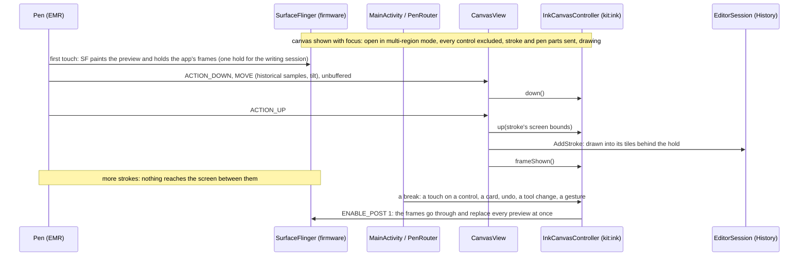

# 08 · Nib: the drawing app

Nib (`:nib`, package `app.booxultimatum.nib`) is the suite's drawing app for Boox tablets, built on the pure-Kotlin engine in `:nib-engine` and the kit libraries (see [`07-suite.md`](07-suite.md)). Its aim is to join the instant pen of Boox Notes to an interface at Sketchbook's level: many brushes, very thin widths, unlimited layers, and tools that float over a full-screen canvas. This document describes Nib as built after the redesign that followed 0.1. Its visual world is recorded in [`DESIGN.md`](../DESIGN.md).

In this document, *the display* means the screen's own electronics, which draw the pen's ink before any app does. Nib's setting for using them is *Instant ink*. SurfaceFlinger is Android's compositor, the part of the firmware that puts every app's frames on the screen. On Boox firmware it also draws the pen preview and can hold an app's frames back. Everywhere else the document says *the screen*. The floating controls are called *cards* in the app and *panels* in the code (`FloatingPanel`) and in Settings › Layout.

Nib's pen preview was tested on the maintainer's Note Air6 C (firmware 4.3) for 0.2.0: the preview, its width, the first stroke, the cards left out of the preview, and marker colours (`knowledge/experiments.md`, 2026-09-28). From 0.3 Nib writes the way Boox's own apps do, on `kit:ink`'s ink framework ([`09-ink.md`](09-ink.md)). *Verified and not* below says what's still open. Nib's own Diagnostics page exists to check it. On the emulator and on tablets without a display pen path, Nib is a software-only drawing app, and that mode is what the automated tests cover.

## The pieces

| Area | Files (under `nib/src/main/java/app/booxultimatum/nib/`) | What they do |
|---|---|---|
| Shell | `NibApplication`, `MainActivity`, `NibSettings` | Logbook start, the one activity (it handles rotation itself and sees every pen event first), the settings |
| Pen session | `pen/NibPen` (with `PenRouter`), `pen/PenShields` (with `ScreenAreas`), `pen/RevealPolicy`, `pen/PenParts`, `pen/PanelKind`, `pen/PreviewMatch`, `pen/PressureNormalizer`, `pen/PenRecorderStore`, `pen/FrameLatch` | The process's `InkSession`, the window-level pen router, where the controls and cards lie, when the finished ink replaces the preview, what each part of the pen draws, the screen's re-arm wait, the preview's size, pressure scaling, the pen recorder, when SurfaceFlinger has the frame with a stroke |
| Canvas | `editor/CanvasView`, `editor/EditorSession`, `editor/ToolState`, `editor/Selection`, `editor/StraightLine`, `editor/OpenSessions`, `editor/MultiTapDetector` | Input, the view of the page, one open drawing with its history and autosave, the state of the pens and tools, the lasso's selection and its math, the held straight line, multi-finger taps |
| Rendering | `render/CanvasSink`, `render/TileCache`, `render/TileLru`, `render/DabRecording`, `render/DocumentPainter`, `render/GuidesPainter` | The engine's `RenderSink` on an Android `Canvas`, per-layer tiles, their memory policy, per-tile dab replay, whole-page pictures, the paper's guides |
| Files | `store/DrawingStore`, `store/Paper`, `store/AutoSaver`, `store/CompactionPolicy` | The library on disk, a drawing's paper, journaling and snapshots |
| Brushes | `brush/Presets` (presets and their tuning, pressure presets, groups, preview policy), `brush/WidthSteps`, `brush/Palette` | What the pens hold |
| Design system | `ui/studio/Studio` (tokens and type), `Components`, `Sliders`, `FloatingPanel`, `PanelPlacement`, `Entry`, `Samples`, `StudioGlyphs`, `ValueScale` | Nib's cut-card world: slabs, buttons (`StudioKey`), pills, sliders and their math, floating cards and their placement, the entry bar, engine-drawn pictures, the glyphs |
| Screens | `ui/NibApp`, `ui/LibraryScreen`, `ui/EditorScreen`, `ui/BrushPanels`, `ui/ColourPanel`, `ui/LayersPanel`, `ui/DocumentPanels`, `ui/SettingsScreen`, `ui/DiagnosticsScreen`, `ui/AboutScreen`, `ui/Screens`, `ui/Names` | The library, the editor and its floating cards, Settings, Diagnostics, About Nib |
| Diagnostics | `diag/Probes`, `diag/ProbeView`, `diag/Lab`, `ui/LabScreen` | The probes and their banded pen surface, and the Lab, which checks each display call not yet verified |
| Export | `export/Exporter`, `export/LogShare` | PNG with or without paper and layer zips, to the gallery and to other apps, the log zip |

## From pen to finished ink

- **One hold per writing session.** The display holds Nib's frames from the first touch, and quick strokes follow each other with nothing reaching the screen in between, as in Boox Notes and NeoReader (Boox's reader app), traced on the maintainer's Note Air6 C. Nib draws each stroke behind the hold. The hold ends at a break: a pen or finger touch on a control; tool, brush, colour or size changes; undo and redo and any other edit that isn't a stroke; layer, paper and rotation changes; export, share and the library. These block the preview: cards, focus loss, selection, a locked or hidden layer, the eraser tool, the eyedropper and the hand. A release waits for the frame that holds the last stroke: SurfaceFlinger says when it has taken it (`FrameLatch`), so the preview is never replaced by an older frame.
- **Instant ink is a switch** (Settings › Writing › *Instant ink (experimental)*, on by default). Off, the editor never opens a display pen session. `CanvasView.updateSessionOpen` skips `controller.open`, the session stays closed, `controller.available` is false, and every display call the canvas makes (the preview, fast gestures, Palm guard, the page refresh) is skipped. Nib then draws and commits every stroke itself, as it does on a tablet with no display route. Diagnostics keeps its own sessions, since it exists to test the display. The setting applies when a drawing is next opened, because Settings replaces the editor on screen. Checked on the emulator: on, the canvas logs `canvas session opened=false state=Unavailable`. Off, it makes no attempt, and a stylus stroke commits with `previewed=false`.
- **Showing the finished ink** (Settings › Writing › *Show the finished ink*) can happen in four ways:
  - *At breaks*, as the native apps do.
  - *After a pause* (400 to 2000 ms, 800 by default, set with *Pause before the finished ink*): Nib pushes its exact rendering of the strokes since the last one into the display's layer (`HandwritingLayer`, from the whole window so a card over the ink stays on top), keeping the hold. It lets the frames through instead when the area is over 4 MB or the push is refused.
  - *After every stroke*, as 0.2 did.
  - **Auto**, the default: at breaks for the ten pens the display previews faithfully (fineliner, fountain pen, ballpoint, pencil, marker, brush pen, neo brush, both calligraphies, square pen), and after a pause for the rest. That includes the other textured brushes, translucent ink, a layer that isn't plain, and a see-through-grey marker on a colour screen.
- **Controls stay current during a hold.** Each pill declares what it shows (undo and redo, the active slot, the sizes, the view chip, the selection bar). When that changes, only that pill's area is pushed into the display's layer.
- **Every control is excluded.** All shielded controls, plus the strips of screen around the canvas, go to the display in one call, so the preview never lands on them. They're resent when the layout changes, and held back while the pen touches.
- **Pen parts.** The display gets a configuration for the canvas area:
  - The tip draws exactly the stroke sent, with the brush's own style parameters: fountain sensitivity and smoothing, charcoal tilt, the calligraphy nib's angle.
  - The eraser end draws the eraser track (style 8). Nib erases from the eraser end's samples at the lift and then releases.
  - With Settings › Writing › *Preview the eraser end* off, the eraser end blocks the preview and erases live, as before.
- **The lasso** is drawn by the display in its dashed style and released at the lift, before the selection appears.
- **Finger gestures.** Once fingers move the page about 4 dp, the display switches to its fast mode (A2 quality, the firmware's optimised animation mode with dither). The fast mode ends 600 ms after the gesture, or at once when the pen touches, with a reset that cleans the screen. You can turn it off in Settings › Display › *Fast refresh while things move*.
- **Palm guard** (Settings › Fingers, off by default until verified): while the pen is near, finger touch is turned off over the canvas except the controls. It comes back 500 ms after the pen leaves.
- **Refreshes.** One Regal refresh (the Boox refresh mode with minimal ghosting) runs after a drawing opens or a card closes, at most every 1.5 s and never during a hold. Menu › *Refresh screen* cleans the whole screen.
- **Re-arming.** After a pause, the preview starts again once the screen has finished its update. That takes 500 ms on colour screens and 200 ms on others, as NeoReader waits for the screen, unless the pen touches first.
- **Opening and crashes.** The canvas opens the session once it's attached, resumed and focused, and closes it on `ON_PAUSE` and when it leaves the screen. It opens drawing unless something blocks it. One session exists per process (`NibPen.session`). The canvas and the Diagnostics pages take turns with it, and a view that attaches just as another leaves retries opening once. `NibApplication` attaches `InkGuard`, which undoes whatever a Nib that died mid-session left on the display. It also ends a session recorded by 0.2's lease file.
- **The preview's size.** The display gets the brush's width × zoom. For styles whose preview follows pressure itself (fountain, brush, square pen, charcoals), nothing more is sent. **A pen's width is the page's**, as in any drawing app (0.4.1): a stroke is the same number of document pixels wide whatever the zoom it was drawn at, so it is bigger on screen in proportion when zoomed in. Two styles draw more than they're sent by a constant number of screen pixels: the display's fountain 3 (as Boox Notes allows for in its own fountain ink) and its charcoal v2 5 (a stamp is `1.16 w + 5`). For those two, `BrushSpec.sentWidthPx` sends less than width × zoom, by just that constant. `BrushSpec.inkAt` commits the width the display draws, which is the same on the page at every zoom and the same as the preview. The fountain pen's 2 px floor and its speed thinning are still measured on screen. Where the display can't be sent less (its thinnest preview, 1 px), the stroke is as thin on screen as it can show, which happens only when zoomed far out. Before, the display was sent the width times the zoom, so those constants made a stroke drawn zoomed in thinner on the page than one drawn at 100 % (a 2.5 px pencil: 7.9 px at 100 %, 4.6 at 300 %, 3.5 at 800 %). For constant-width previews (pencil, marker) of brushes that thin with pressure, `PreviewMatch` still sends the width at your typical pressure, which Nib learns as you draw. The per-style factor in Diagnostics › Match preview applies to all.
- **Software-only.** When the display offers no route (the emulator, other tablets, a changed firmware), the session stays unavailable, every call does nothing, and the canvas draws the stroke under way itself.

## Input

- Stylus events (tool type `STYLUS` or `ERASER`) go straight to the engine's `StrokeBuilder` in document pixels, mapped through the view's zoom, pan and turn, historical samples included, with `requestUnbufferedDispatch` on the down. Tilt comes from `AXIS_TILT`. Orientation comes from `AXIS_ORIENTATION`, less the page's turn, so a flat nib keeps its angle to the paper.
- Pressure is divided by the stylus's `AXIS_PRESSURE` range maximum when Android reports one, and by `SurfaceInk.maxTouchPressure` for raw readings above 1 when it doesn't (`PressureNormalizer`). A lift that reports zero pressure keeps the pressure before it, so strokes don't thin at their very end.
- **Tools.** The pen draws with the chosen slot. The eraser end, the side button and the eraser tool erase with the chosen eraser. The lasso draws a loop, then moves, resizes and turns what it chose. The eyedropper takes the colour of the page under the pen (paper, guides and every visible layer, rendered from the vectors at that point) and hands back to the pen. The hand turns the page about the view's centre with the pen or one finger, snapping upright to 0°, 90°, 180° and 270° within 5°.
- **The straight line.** When the pen rests at a stroke's end for about 500 ms (within 6 dp), the stroke becomes a straight segment from where it began to where the pen is, and keeps following the pen until the lift. Its pressure along the segment comes from the drawn path at the same fraction of its length (`StraightLine`). A resting pen keeps reporting, so the wait restarts only when the pen moves on. On a tablet with the display route, the display previews the stroke as drawn and the straight line replaces it at the swap *[verify]*. You can turn it off in Settings › Writing › *Hold to draw a straight line*.
- Palm rejection: fingers are ignored while the pen hovers over the canvas, while it draws or holds a tool, and for 600 ms after its last event.
- Fingers: two fingers pinch (`ScaleGestureDetector`), pan and twist together, and the twist turns the page and snaps to a quarter turn within 5°. One finger pans (*One finger moves the page*, on by default) or draws (*Draw with a finger*, off by default), and with the lasso, eyedropper or hand it works that tool. Two fingers tapped together undo and three redo (`MultiTapDetector`).

## Rendering and tiles

- `CanvasSink` is the engine's `RenderSink` on an Android `Canvas`: paths fill with the nonzero rule, groups are `saveLayer`s with the group's alpha and blend, dashes use `DashPathEffect`. Blends map to `BlendMode`: Normal to `SRC_OVER`, Multiply to `MULTIPLY`, Erase to `DST_OUT`, Atop to `SRC_ATOP`.
- Each frame draws the desk (flat grey with a cutting-mat grid fixed to the screen), then the page as a turned rectangle with a 6 dp black shadow, its paper colour, and its guides under the layers.
- Each layer's strokes are rendered, without the layer's opacity or blend, into 256 px ARGB tiles at the current zoom level. The engine's `TileGrid.scaleBucket` defines a level as the zoom in 1/4096ths. A view that settles after a zoom is snapped onto its level, so each tile is drawn 1:1 on the screen and the stipple pencil's dots reach it as they were worked out, instead of resampled. A pinch keeps the level it began at, and the tiles are drawn again once, when it ends. **Tiles stay upright in document space**: the view's mapping is split into an upright part (`Viewport.unrotated()`) that places the tiles and a turn (`Viewport.turn()`) applied to the canvas once, so a turned page costs no re-rendering and no tile ever has to be drawn at an angle. Tiles exist only where a stroke's ink can reach. Each frame composites the visible tiles of each visible layer.
- A committed stroke is drawn into each tile it reaches on the main thread, so it's in the very next frame. Dab and stipple strokes replay only their own stamps per tile (`DabRecording`), and a stroke crossing many tiles is recorded once per zoom level, for the worker and for `renderNow`. Edits the lasso makes (a recolour, a duplicate, a deletion, a move to another layer) and the undo and redo of transforms re-render their tiles at once on the main thread (`TileCache.renderNow`, at most 24 tiles; more go to the worker), so a changed selection never shows its old self while the worker catches up. A move, resize or turn is shown by the lift instead (below), and its tiles go to the worker. Anything else re-renders tiles from the vectors on up to three background threads. After a zoom the tiles of the level before stay on screen, scaled, until every tile of the new level that is on screen is ready. The page then changes in one frame instead of square by square (`TileCache.drawLayer`; a stroke or an edit made meanwhile shows at once in the tiles it touches).
- **The lift** (`editor/SelectionLift`, from 0.3.0). A selection is drawn once into a bitmap at the tiles' level and on their pixel lattice, on a thread of its own, as soon as it's chosen or moved or the view settles. When a drag starts, each of the layer's tiles under it is copied with exactly those pixels taken out. That hole is made in the tile's own pixels, because erasing on screen after scaling left faint outlines. Each frame draws the holes in place of their tiles and the lifted bitmap through the drag's transform. The drag also turns on the display's fast mode, as a moving page does. After the drop the tiles are invalidated, and until each is current its hole and the lifted bitmap stand in for it (`TileCache.forEachPending`), so the main thread doesn't wait and nothing jumps back. A drag that used to draw every selected stroke twice a frame took seconds per frame with the stipple pencil.
- **Stipple runs.** The renderer hands a sink all of a stroke's stipple stamps at once (`RenderSink.stippleRun`). `Stipple.stamps` reports each pixel once and skips pixels already on (stamps overlap about seven deep), and `CanvasSink` writes them into a bitmap as one alpha mask, drawn unscaled at their screen pixels, rather than as points.
- While a selection is dragged, its strokes are lifted out of the layer the way the stroke eraser previews (drawn with `DST_OUT` in the layer's group) and drawn where they are going.
- **The stroke eraser** (`editor/EraseMask`, 0.4.1). Each stroke it crosses is drawn once into a view-sized alpha picture on the tiles' pixel lattice (the view's offset rounded, as a tile's place is). Every frame takes that one picture out of the layer's group with `DST_OUT`, so a frame costs the same however many strokes have been crossed. It used to draw every crossed stroke again each frame, which with the stipple pencil (thousands of dots a stroke) made the eraser slower with each stroke it passed. After the lift the picture stays until the layer's tiles are drawn again without the strokes, so they don't come back for a moment. An undo or any other edit ends it. A crossed stroke that overlaps one the eraser hasn't reached takes a notch out of the other until the lift.
- Layer property changes (visibility, lock, opacity, blend, order) never touch the tiles: they apply when compositing. Memory, eviction and the dab textures are as in 0.1: tiles off screen are dropped least recently used first past a third of the memory class, and tiles on screen never are.

## Documents and autosave

- Files live in `filesDir/drawings/`: `<id>.nib` (the engine's snapshot format, with a 480 px thumbnail), `<id>.journal` (every edit since) and `<id>.meta` (a properties file: the name and page size as 0.1 wrote them, plus the layer count at the last snapshot and the paper: `paper.colour`, `paper.guides`, `paper.spacing`, `paper.export_guides`).
- The file format keeps the major version it had in 0.1, and later versions only add fields (see *Brushes*). 0.1's drawings open as they were: a `.meta` without the new keys reads as plain white paper, and its layer count is read from the snapshot's manifest alone (`NibFile.readSummary`, which decodes no stroke).
- The paper lives beside the drawing rather than in the document, so changing it isn't an undo step and needs no new journal record.
- Journaling, compaction and replay are as in 0.1: every applied edit reaches one background thread in order and is appended and synced there. A fresh snapshot is written every 50 edits, past 8 MB of journal, when the activity stops and when the drawing is closed. Thumbnails draw every stroke at least 1.3 px wide, so thin lines stay visible in the library.
- A drawing stays open while its editor is anywhere on the back stack, so a visit to Settings, Diagnostics or About Nib keeps the undo steps and the view of the page.
- **Export** (`ExportKind`): *With paper* is the page with its paper (and its guides, when *Show the guides in exports* is on). *Transparent* is the ink alone on transparency. *Each layer* is every layer (hidden ones too) as its own transparent PNG in one zip. PNGs are saved through MediaStore into `Pictures/Nib/`, zips into `Download/Nib/`, or written to the cache and offered to other apps through the FileProvider.

## Brushes

- The Brushes card shows every non-eraser brush of the engine's catalogue by family (*Pens*, *Pencils*, *Markers*, *Brushes*, *Textured*), each family drawn as its own tool down the card's side. Each brush is a tile with a sample stroke the engine draws at the pen's width and colour (an S with the pressure rising and falling, rendered off the main thread through `CanvasSink` and cached, one document pixel to one screen pixel), its name, and the display style that previews it, marked ≈ when a verified style stands in.
- A pen (`BrushPreset`) is a brush, a width, a pressure preset, a colour and the tuning you set (`BrushTune`): opacity, the pressure curve's exponent, floor and ceiling, smoothing, dab spacing, flow, grain and scatter, the nib's angle and whether it follows the pen, speed thinning and taper. Untuned pens are written in 0.1's text form. Tuned ones add one field, and damaged values are skipped or clamped.
- **Brush settings** has three pages below a live sample that follows every control as it moves. *Size and ink* has the width on a logarithmic track snapped to a quarter pixel at the thin end, with a dot drawn to scale at the current zoom, and opacity over a checkerboard. It also shows what the display previews and at what width, with a *Match the preview* link to Match preview. *Pressure* has Soft, Medium and Firm as tiles showing their curve and a sample, then *Sensitivity* (the exponent), *Lightest touch* (the floor) and *Hardest press* (the ceiling), with the curve plotted. These apply to the fountain pen only (see *Pressure follows each style's own law* below). A brush that ignores pressure can be made to follow it with *Make it follow pressure*. *Feel* has *Smoothing* with a before-and-after sample of a shaky line, and *Texture* (*Grain*, *Spacing*, *Density*, *Scatter*) for the dab brushes. A nib dial (*Nib*) appears for the two calligraphies and the square pen. *Speed thins the line* and *Tapered ends* appear for a brush that offers them, which none of the current brushes does. *Tilt broadens the line* appears for brushes that use tilt. Every slider has − and + buttons and a value to type.
- **Native-matched pens** (`nib-engine`, from the study of Boox Notes, see [`09-ink.md`](09-ink.md)):
  - The fineliner is the native plain pen (style 0, constant width). The fountain's pressure sensitivity (0.3) and smoothing (0.6) are also sent to the display.
  - The marker is laid down opaque and composited at alpha 128, which is half transparent.
  - The pens follow Boox's measured laws ([`09-ink.md`](09-ink.md) › *Measured pens*): the fountain p^(2s) with speed thinning and a 2 px minimum, the brushes √p, the marker 0.8 + 0.2p. Both charcoals broaden with tilt by Boox's measured curve (tilt response Native) without getting lighter, and pressure sets their coverage.
  - **The pencil is Boox's 1-bit stipple** (from 0.3.0-test.7, `render/Stipple.kt`), the ink the display's charcoal v2 style previews, rebuilt from penlab's measurements. Every pixel is on or off: it is on where a fixed threshold at that page pixel is below the pressure, so the centre of the line covers just the pressure. A stamp is 1.16w + 5 screen pixels for the width w the display is sent, solid to 0.6 of its radius, then fading. Tilt broadens the stamp by Boox's charcoal law without making it lighter, by the brush's tilt scale (Brush settings › Feel › *Tilt broadens the line*, 1× to 6×, sent to the display too). The dots are cells of a lattice fixed to the page, each as big as the stroke's `BrushSpec.dot`. A cell's threshold is a hash of its place on the lattice, so the grain stays put while the page moves. Its stroke is committed with the stamp's diameter in document pixels at the zoom it's drawn at and with `dot` = 1 / that zoom (`BrushSpec.inkAt`), which is the display's dots exactly, one screen pixel. So at the zoom it was drawn at, a tile is the preview, dot for dot (`CanvasSink` works the cells out on the tile's pixels, as before). At any other zoom the grain is scaled with the page, as an image's pixels are, like Procreate. Magnified, each cell is a block of pixels, still on or off and never grey (the very same dots, so zooming in and back out returns the same picture). Shrunk, the cells under a pixel are averaged into their tone, in grey (`CanvasSink.latticeRun`; the blocks are those of the whole lattice, so tiles meet without a seam). `dot` is stored in the stroke (format 1.3, brush field 24), and strokes drawn before have 1, one document pixel. Tiles draw the stroke directly rather than from a recorded picture. Opacity and the width-from-pressure curve aren't offered for it, because the preview can't follow them. The pencil before it (`GrainPencil`, id `pencil`, *Pencil (before 0.3)* in the app) is kept only for the strokes drawn with it. Slots holding it move to the new pencil with their width and colour.
  - Graphite doesn't use tilt, as in Boox Notes' plain pen. New brush fields (tilt response, speed damping, minimum width) are format 1.2, and strokes saved before keep the old eased tilt and draw exactly as before.
  - **Only what the preview can show** (from 0.3.0-test.8): the brush pen is Boox's brush, without the taper and speed thinning the display's brush style can't draw. The highlighter's nib is round, as the marker style draws it, where a flat chisel made its ink as little as a third of the preview's width. Strokes keep the fields they were drawn with, so older ones keep their taper and chisel. `BrushPreset.spec` ignores speed and taper tuning on brushes that no longer offer them, and Brush settings hides the nib dial on a round-nibbed brush.
  - **Pressure follows each style's own law** (from 0.3.0-test.10): only the fountain style takes a pressure response from the app (its sensitivity), so pressure presets and a tuned curve apply to the fountain pen alone (`PressurePreset.applies`). Every other pen keeps its style's law: the brush style's √p, measured on the display itself; the marker's 0.8 to 1; none for the pencil and plain pen styles; none for the square pen style, so the calligraphy and square pens no longer thin at a light touch. Brush settings › Pressure explains this for those pens instead of offering presets.
  - *Latin calligraphy* (+45°) and *Asian calligraphy* (−45°) use a flat nib.
  - Every display style the native app uses is offered, and only dash still needs *Try unverified preview styles*. Drawings from 0.2 and the 0.3 test builds open unchanged (golden-file tests for formats 1.0 and 1.1). Files are now format 1.3 (the pencil's dot size, above).
- **Input.** Tilt and orientation come with every sample. As in the native pen reader, a move sample is dropped when it's slower than 0.005 px/ms with the pressure within 2 of 4096 levels, but only within 2 px of the last sample kept, so a slow, careful line keeps its shape.
- **Marker colours.** The display's Marker style drops a translucent preview in any colour but grey or yellow (tested on a Note Air6 C). So the Marker style's colour goes through `MarkerPreview` (engine). *Solid colour*, the default, sends the colour opaque, which covers what's under the stroke until the swap. *See-through grey* sends a half-transparent grey as light as the colour, never lighter than #BBBBBB, the lightest seen showing. The choice is Settings › Display › *Marker and highlighter preview*, and it applies to the marker, highlighter and airbrush, which all preview in the marker style.
- **Colours**: a saturation and brightness square with a hue strip, the twelve swatches tuned for Kaleido 3 screens (E Ink's colour screen technology), the eight colours used lately, a hex field, and the eyedropper.

## The view

Zoom runs from 25 % to 1600 % by pinching or from the View card (*Fit page*, *100 %*, and *Zoom in* and *Zoom out* by √2). The page turns by twisting two fingers, with the hand tool, or from the View card (quarter turns or a typed angle), and snaps upright within 5°. The engine's `Viewport` holds the turn: `view = R(rotation) · (doc · scale) + offset`, with `rotateAround`, `rotatedTo`, `unrotated`, `turn` and `fit`, which stands the page upright again. Quarter turns map exactly. The view chip reads "78 % · 12°", and *Show the whole page, upright* fits the page and sets the turn to 0°. The display's preview width is the brush width × zoom (through `PreviewMatch` for constant-width previews), which a turn doesn't change. The calligraphy nib's angle sent to the display follows the turn. When the tablet rotates, a page that was fitted and left alone is fitted again. Otherwise the document point at the centre stays at the centre.

## The interface

- **Library:** the top shows the wordmark with the count, and Settings, Diagnostics and About Nib in a pill. Below are a search field (*Search drawings*) and an order (*Recent*, *Name*, *Size*). The *New drawing* card comes first on the first page. It opens page sizes drawn at their shape (the tablet's own screen in portrait and landscape, A4, A5 and a square) and *Your own size* in pixels or millimetres at 300 ppi. Drawings are cards with the thumbnail on its paper, the name, the date and the layer count, each with a menu (open, rename, duplicate, export, delete with a confirm). *Choose several* exports or deletes drawings together. An empty library (*No drawings yet*) shows an illustration drawn by the engine itself. The library is paged, not scrolled.
- **Editor:** see [`DESIGN.md`](../DESIGN.md) › Layout for the first viewport. Tapping a pen slot chooses it. Tapping the chosen one opens Brush settings, and tapping the eraser again opens the Eraser card. *Full screen* hides everything but a small corner button.
- **Settings** (from 0.3.0) is four pages chosen at the top, each a screen's worth. *Writing* has *Instant ink (experimental)*, *Hold to draw a straight line*, *Preview the eraser end*, and *Show the finished ink* with the pause it waits. *Display* has *Marker and highlighter preview*, *Fast refresh while things move*, and the *Match the preview* button. *Fingers* has *Draw with a finger*, *One finger moves the page* and *Palm guard*. *Layout* has *Tools on the right* and *Restore every card beside its button*. Diagnostics keeps only switches for testing the tablet.
- **Floating cards:** Brushes, Brush settings, Colour, Layers, Eraser, View, Export, Paper, Menu and Move to another layer open as cards beside their button. They can be dragged by their header and pinned, and they remember where they were per orientation (`PanelMemory`). An unpinned card closes when the pen or a finger touches the canvas, and the pen's touch that closes it doesn't draw.
- **Layers:** pages of layers, top first, each with a thumbnail the engine draws over a checkerboard, its name, visibility and lock. For the active one you can rename it, set its opacity on a slider and its blend (Normal, Multiply, Clip, the engine's `Atop`), and keep its transparency (`alphaLock`). You can also move it up and down, duplicate it, merge it down (a second tap when it can't be exact, per `MergeDown.isExact`) and delete it (a second tap). Every change goes through the engine's `History`, so all of it undoes. There is no limit on the number of layers.
- **Lasso selection:** strokes of the active layer mostly inside the loop (`insideLasso`) are chosen and framed with corner handles (resize about the opposite corner, uniformly) and a turn handle (about the frame's centre, snapping to 45° steps within 3°). Dragging inside moves them. Each move, resize or turn is one `TransformStrokes` step, and the frame turns with the strokes. The selection bar moves them to another layer (`MoveStrokes`), duplicates them (`InsertStrokes`, offset a little), gives them the pen's colour (`ReplaceStrokes`), deletes them (a second tap) or ends the selection (*Done*). Undo and redo end it.
- **Paper:** white, warm, grey or black, and guides (none, dots, grid or lines) at a spacing from 20 to 400 px, drawn under the layers and never part of the ink.
- **Typed values** go in the entry bar at the top of the screen, where the keyboard can't cover it. Nib checks the value, clamps it to its range and tells you when it did. The keyboard never resizes the canvas.
- The canvas is one Android view inside Compose, kept at the same place in the composition in both orientations, so rotating never recreates it. The activity handles every configuration change itself. Panel changes never redraw the canvas.

## Diagnostics probes

The Diagnostics page is for running on a tablet when no developer is there to watch. Each probe logs a `nib.probe` event per stroke and per answer, with the band, style, width, colour, delay, route and session state, so the answers come back with *Share logs* in About Nib.

| Probe | Bands | The question |
|---|---|---|
| Status | none | The display pen path (route and pressure range), the pen session state, the tablet and stylus, *Try unverified preview styles*, *Extra swap delay* and the pen recorder |
| Match preview | fountain pen 4 px, pencil 4 px, marker 16 px | Does the preview look as wide as the stroke that replaces it? Each style's preview size (×0.3 to ×1.6 in steps of 0.05, on a slider with − and + and a typed value), the typical pressure learnt so far, and *Learn again*. The answers are *Preview wider*, *Matches* and *Preview thinner* |
| Styles | the eight firmware styles, 4 px black, sized like the editor's and with each style's parameters | Does each style preview as named, and swap cleanly? Styles not yet seen working are marked *not seen on this tablet yet* |
| Widths · fountain, Widths · pencil | 0.5, 0.75, 1, 1.5, 2 and 3 px | Which thin widths does the display draw cleanly? |
| Colour | red, blue, green, 50 % grey, translucent black on fountain and on pencil | Does the preview show colour on a Kaleido screen, and does translucency break it? |
| Marker colours | the marker style at 16 px: red half transparent (the current way), red opaque, red blended with white, red as a grey half transparent, blue opaque, blue as a grey half transparent, and mid grey and light grey half transparent | Which ways of sending a colour does the marker style show? (Answered on a Note Air6 C: opaque colours and every grey, not translucent colours) |
| Swap delay | 0, 16, 50 and 120 ms of extra wait | Does any delay avoid flicker when the preview is replaced? |
| Lab | thirteen pages | One check for each display call not yet verified on a Note Air6 C: pushing ink after a pause (*Push ink*), pushing a control during a hold (*Push controls*), the eraser end's track (*Eraser end*), the dashed lasso (*Lasso*), the fast mode on and off (*Fast mode*), *Palm guard*, the style parameters live (*Style settings*, with the originals restored on leaving), a limit in screen coordinates (*Limit*), the display's own stroke widths (*Fed stroke*), pen state 4 (*Pen state 4*), nine ways to draw the eraser's track (*Eraser painters*), the display's geometry for the current rotation (*Geometry*), and the two ways of cleaning the screen (*Clean screen*) |

In Match preview the bands' previews are sized through `PreviewMatch` exactly as the canvas sizes them. Every size change is logged (`match factor`) and resent to the band the pen is in, and every answer is logged (`match answer`, with the preview width sent, the brush width, the factor and the typical pressure). Brush settings links to it. The pen recorder, off by default and in memory only, keeps the raw samples of the last 50 strokes and shares them as a `.penrec`.

## Logging

Nib logs through `kit:log` in every build. `nib.pen` has one summary per stroke, never one per sample. The summary holds the points, samples, duration, sample rate, and pressure range and mean, and the tool, brush and width. It also says whether the stroke was previewed, held or straightened, which hold it belonged to and how its ink was shown. It ends with the preview style, width and size factor, the typical pressure, the commit time, the zoom and turn, and the time since the session opened. At Info, `nib.pen` also has one line per hold (strokes, time held, why it ended), the preview policy, the pen parts sent, the fast mode and Palm guard. Pushes into the display's layer are logged at Debug (area, time, whether they were accepted). `nib.render` has tile batches and commits, including renders done at once. `nib.doc` has opening, replay, snapshots, compaction, exports and paper changes. `nib.ui` has settings, selections, view resets and turns, and `nib.probe` the rest. Drawing ids are hashed with `Redact.hash`, and drawing names and contents are never logged.

## Verified and not

- Verified on the emulator (Android 16, 1860 × 2480 at 300 dpi, no Boox firmware): software-only drawing with live rendering, every brush and eraser, layers, undo and redo, autosave with replay and compaction, the three kinds of export, the turned page (drawing lands where the pen is), *Show the whole page, upright*, lasso moves, duplicates and deletes with undo, typed values with clamping, the eyedropper, the held straight line, the pen over a floating card, a 0.1-style drawing opening, both orientations with the canvas kept, palm rejection and pinch zoom (instrumented tests), and the release build under R8.
- Verified on the maintainer's Note Air6 C (firmware 4.3, 0.2.0 test builds): the canvas's session previews strokes and the swap replaces them. The preview matches the stroke's width at ×1 in the Match preview bands (in daily drawing it can still look a little wider). The first stroke after opening is whole. The cards stay out of the preview and strokes next to them start whole. The Marker style's colours are as above.
- Verified on the maintainer's Note Air6 C with 0.3.0-test.6 (2026-10-06), using Android's stylus input command, which reaches Nib but not the display's own pen reader: SurfaceFlinger reports the frame of every held stroke (`hold … latched=3` for three strokes), and a 4 px fountain band lays down 6.5 px of ink at full pressure, the padded law.
- Not yet seen on a Note Air6 C *[verify]*: everything in the Lab, and the whole 0.3 choreography (one hold per session, releases at breaks, Auto). Also not yet seen: the tilt thresholds, whether `InkGuard` and BooxUltimatum home's stray-session check end a session a killed Nib left (unit-tested), styles 3 to 7 with their parameters, the thinnest width the preview draws cleanly, colour in the other styles beyond Nib's blue pen, the pen's pressure range as Android reports it, the commit, tile and at-once render times on its processor, how the straight line looks when its drawn preview is replaced, and how the cut-card chrome refreshes and ghosts on the screen.

## Known limits

- Committing a stroke, and editing a selection, blocks the main thread while their tiles are drawn. On the emulator's host a fountain-pen line across the page (17 tiles) takes about 8 to 21 ms and a charcoal one about 50 ms. A Note Air6 C's processor is likely several times slower *[verify]*.
- The fountain pen's preview looked wider than its ink, up to twice as wide at a light touch, until 0.3.0-test.6 gave the ink the 3 px the display adds (above). Whether it now looks the same to the eye is the maintainer's check. The pencil's preview was a plain line in the display's pencil style, without its ink's grain or tilt, and the maintainer found it wider than the ink, sometimes much wider (0.3.0-test.6). From 0.3.0-test.7 the pencil is the stipple the display's charcoal v2 style previews, measured to match it statistically (penlab and `StippleTest`), and the maintainer finds preview and ink all but identical at the default tilt (2026-10-07). Its thinnest line is about 6 px, the display's smallest stamp, and thinner lines are the fineliner's. The tiles' levels used to be steps of √2, so a zoom between two of them resampled the pencil's dots instead of showing one screen pixel each. Since 0.4.1 a level is the zoom in 1/4096ths and a view that settles is snapped onto its level (see *Rendering and tiles*), so the dots reach the screen as they were worked out, at every zoom. The maintainer checked this on the tablet through 0.4.1's test builds.
- The straight line snaps under the pen only in software. On a tablet with the display route, the drawn stroke stays in the preview until the ink is shown.
- During a hold, the canvas shows the display's preview, not Nib's ink. With the native-matched pens they look alike, and with other brushes Auto pushes Nib's ink after a pause.
- Many large layers full of ink can need more tile memory than the budget, and the tiles on screen are kept regardless.
- The pencil's grain scales with the page, so a stroke looks the same at every zoom, magnified or shrunk like an image. Magnified it is blocks of pixels (nearest, so the dots stay black or white). The display's preview of a stroke being written is the dots of the screen, so a stroke is exactly its preview only at the zoom it was drawn at. Strokes drawn before the dot size was stored (0.4.1) have one-document-pixel dots, so at fit-to-screen they look smoother than they did, and at 100 % as before. A selection lifted for a drag at a zoom much smaller than its stroke's can show a faint outline of the strokes where the lift and the tiles average their dots a little differently.
- Drawing a zoom's tiles again took 1.0 to 2.1 s on the emulator for a page of 14 pencil strokes before the zoom work, and about 0.25 to 0.4 s after. That is a batch's wall time in the `nib.render` log, which is how to check it. A Note Air6 C's processor is slower *[verify]*, so a page full of pencil strokes can still take a moment to show its new zoom.
- A duplicated layer's or selection's textured strokes get new ids, and the engine seeds dab scatter by stroke id, so their grain differs slightly from the originals.
- The library's layer count is as of the drawing's last snapshot, and edits journaled since show after the next one.
- Pages are fixed at creation, and there is no crop, resize or text yet. Resizing a selection resizes its brush widths too, beyond the brush's own range.
- The pixel eraser's live preview erases in view pixels and the tiles re-render exactly after the lift, which can show as a small change on e-ink.

## Testing

- JVM unit tests (`.\gradlew.bat :nib:testDebugUnitTest`): the choreography on Nib's side against a fake display and clock (`CanvasChoreographyTest`), the reveal policy, the pen parts, the shields and screen areas, the re-arm wait, the Lab, width steps, the palette, hex, HSV and recent colours, presets, their tuning and text forms, pressure presets, preview stand-ins and `PreviewMatch`, slider math (the log width track, snapping, stepping, typed values, percentages), panel placement and memory per orientation, lasso math (move, resize from a corner, turn with snapping, handle hits), the held straight line, the library's order, search and page sizes, the tile LRU and reach test, per-tile dab replay, compaction scheduling, multi-finger taps, pressure scaling, the probes, the view readouts and routes.
- Engine tests (`.\gradlew.bat :nib-engine:test`) add the turned `Viewport` (round trips at many angles, quarter turns exact, turning about a focus, zoom and pan on a turned page, fit standing the page upright, the upright frame times the turn, the visible area, snapping) and the manifest-only summary and thumbnail.
- Instrumented tests on the `NoteAir6C` emulator (`.\gradlew.bat :nib:connectedDebugAndroidTest`, with only the emulator attached: disconnect the tablet first, see the tablet-testing skill): 0.1's twelve (a stroke into the canvas and through the window, undo and redo, layers, erasers, tiles, save and reopen, rotation keeping the canvas, export, pinch and palm rejection, pen hover, the recorder) and `StudioEditorTest`: drawing on a turned page, *Show the whole page, upright*, lasso move, duplicate and delete with undo, typed width with a refused entry and clamping, the eyedropper, the held straight line, the pen over a floating card, every floating control left out of the preview, the three exports, and a 0.1-style drawing opening. Controls are found and tapped through the accessibility tree.
- On a tablet, run the Diagnostics probes (Match preview first), then *Share logs* from About Nib. Test builds go out on the suite's test channel. Leave Nib before installing a new build over adb (Android's debugging tool, which a computer uses to talk to the tablet): `install -r` kills it without a pause, and before 0.2.0 that left the display's session drawing.
